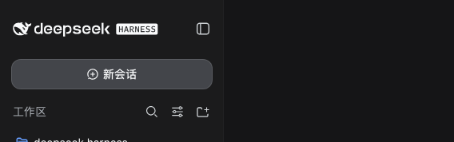
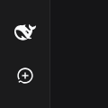

English | [简体中文](README.md)

# dsh-balance-monitor

DeepSeek balance and spend windows, right in the dsh sidebar footer.

A minimal [DeepSeek Harness](https://github.com/deepseek-ai/deepseek-harness) (dsh) plugin that shows the current session's channel balance/usage in the sidebar footer, styled with the stock design tokens. The **DeepSeek official channel** shows balance plus today / 7-day / 30-day spend windows (official usage data when a platform token is set); the **Volcano Ark channel** shows Agent Plan quota bars (5h / weekly / monthly); the **Command Code channel** shows 5h / weekly / monthly usage windows (GOAT / Pro / Max plans); the **Google AI Pro channel** (Antigravity reversed through CLIProxyAPI) shows the Gemini 5h / weekly remaining quota.

<p align="center">
  
  
</p>

## Features

| What | How |
|---|---|
| Live balance | Queries `GET https://api.deepseek.com/user/balance` through the host half, using the `DEEPSEEK_API_KEY` from `$DSH_HOME/.credentials.yaml` (env var wins) |
| Today / 7d / 30d spend (official) | With `DEEPSEEK_PLATFORM_TOKEN` set, the host queries the official usage API `platform.deepseek.com/api/v0/usage/cost` (the same data the platform console shows) and sums per-day windows: 7d = today minus 6 days, 30d = today minus 29 days (both inclusive). Accurate no matter where else the API key is used |
| Balance-delta fallback | Without the platform token (or when the official API fails), today falls back to a balance-drop ledger (only accumulating drops; refills never inflate or wash out spend); 7d/30d show `—` |
| Channel awareness | The card follows the current session's model provider: the DeepSeek official channel shows balance/spend; the Volcano Ark channel shows Agent Plan bars; the Command Code channel shows usage windows; the Google AI Pro channel (`cliproxy`) shows 5h / weekly remaining quota; other channels show a "channel not supported" placeholder; no session renders nothing |
| Volcano Ark Agent Plan | With AK/SK configured, calls the `GetAFPUsage` control-plane API (SigV4 signed) and shows 5h / weekly / monthly quota bars, colored by usage (green → amber → red) |
| Command Code usage | With `COMMANDCODE_API_KEY` configured, calls `api.commandcode.ai/alpha/billing/credits` etc. and shows 5h / weekly / monthly used % with reset countdowns |
| Google AI Pro quota | With the CPA base URL and Basic auth configured, reads the static quota snapshot your server publishes at `GET /v0/google/quota` and shows the Gemini 5h / weekly remaining (rendered as used %) plus reset countdowns; the snapshot is produced by a probe on your server that only calls Google when "a session happened + the cooldown is over" (1 h cooldown after both success and failure). The CPA management key is no longer needed since 0.9.0. **The server side is yours to build — see [the setup guide](#setting-up-the-google-ai-pro-cliproxyapi-channel)** |
| Claude Pro official quota | With CPA management URL configured, reads the official OAuth usage snapshot (`/v0/claude/quota`) probed by CPA timer scripts, showing 5h session and 7-day weekly utilized % and official reset countdowns |
| Placement | Registered on the official `sidebar.footer.action` slot — above Settings, no patch hacks |
| Collapsed rail | Shrinks to a 36px circle with a compact balance and a tooltip |
| Resilience | 60s polling + re-poll on tab visibility; on upstream failure the last known numbers stay visible (dimmed as stale) instead of an error flash |

## Install

Works from source directly — the browser bundle is a hand-written classic script with **no build step**, so a git install needs no prepare script:

```sh
dsh plugin --profile web add "github:alanzhao0128/dsh-balance-monitor#main"
```

or from npm:

```sh
dsh plugin --profile web add @alanzhao/dsh-balance-monitor
```

Then restart the Web UI (`dsh --profile web`). The widget appears at the bottom of the expanded sidebar, above Settings.

> **Version requirement**: `0.8.2+` is compatible with dsh `>= 0.1.2-rc.1` (fully supports DSH Desktop `0.2.1-rc.2` and higher with first-class `engines.dsh` declaration and SettingsForms dual-engine adaptation). On a dsh `0.1.2-rc.1` host, pin `0.7.1`.

## Configuration

### Settings panel (recommended)

Open dsh settings (gear) → **Balance Monitor** to edit the card's behaviour; saving writes the `dsh-balance-monitor:` section of `~/.dsh/settings.yaml` and applies immediately (a few fields after restart):

| Group | Field | Default | Purpose |
|---|---|---|---|
| Display | `ui.showCard` | `true` | Turning this off hides all channel cards |
| Display | `ui.warnThreshold` | `30` | Bar turns amber at this used % |
| Display | `ui.dangerThreshold` | `70` | Bar turns red at this used % |
| Refresh | `ui.pollMs` | `60` s | Card refresh interval (the panel shows seconds; stored internally as ms) |
| Network | `network.cacheMs` | `40` s | Host quota cache; keep below the card refresh interval |
| Network | `network.timeoutMs` | `20` s | Upstream timeout (Volcano Ark / Command Code / DeepSeek official usage / CPA management API) |
| Network | `network.cpaBaseUrl` | empty | **Your own** CLIProxyAPI public entry address (quota-snapshot source for the Google AI Pro / Claude Pro channels); when empty that channel reads "CPA base URL not configured" — see [the setup guide](#setting-up-the-google-ai-pro-cliproxyapi-channel) |
| Network | `network.cpaStaleMs` | `1200` s | A CPA snapshot older than this counts as stale and the plugin requests a probe automatically (keep it above the CPA-side schedule) |
| Credentials | `credentials.file` | `.credentials.yaml` | Credentials document filename (relative to `$DSH_HOME`) |

### Channel credentials

The settings panel's **「渠道凭证 / Channel credentials」 group** shows which credentials each channel needs for its balance/usage display, and whether they are read-only (already referenced by the DSH model configuration) or writable:

| Channel | Credential | Interaction |
|---|---|---|
| DeepSeek official | `DEEPSEEK_API_KEY` | read-only (referenced by DSH model config), shows ✅/⚠️ status |
| DeepSeek official | `DEEPSEEK_PLATFORM_TOKEN` | **writable** password box (needed for official spend; expires), with a three-part explainer: what it is / how to get it (platform.deepseek.com → F12 → Console → `JSON.parse(localStorage.getItem('userToken')).value`) / what it does |
| Volcano Ark | `ARK_ACCESS_KEY_ID` | **writable** password box (plugin-specific; dsh models use `HUOSHAN_API_KEY` — a different pair) |
| Volcano Ark | `ARK_SECRET_ACCESS_KEY` | **writable** password box |
| Volcano Ark | region | read-only, auto-follows the DSH model config (parsed from the huoshan provider's `baseURL`, e.g. `cn-beijing`) |
| Command Code | `COMMANDCODE_API_KEY` | read-only (referenced by DSH model config), shows ✅/⚠️ status |
| Google AI Pro | `CPA_BASIC_AUTH` | **writable** password field, `user:pass` — the Basic auth of the nginx in front of CPA |

Writable boxes save through the official `ctx.credentials.set()` into `$DSH_HOME/.credentials.yaml` (`refs:` section, locked + atomic write); the plugin never writes the file itself.

### Credentials

Credentials live in `$DSH_HOME/.credentials.yaml` (write them from the Web UI Models page, or edit the file directly; the plugin reads them through the official `ctx.credentials` service, env vars win):

| Credential | Required | Purpose |
|---|---|---|
| `DEEPSEEK_API_KEY` | ✅ | Balance lookup `api.deepseek.com/user/balance` |
| `DEEPSEEK_PLATFORM_TOKEN` | optional | Official usage (today/7d/30d). Get it: sign in at [platform.deepseek.com](https://platform.deepseek.com) → DevTools Console, run `JSON.parse(localStorage.getItem('userToken')).value`, store the output as the credential |

> ⚠️ `DEEPSEEK_PLATFORM_TOKEN` is a web-session token and **expires** (the official API returns code 40002/40003 when stale). On expiry the card shows a red hint and falls back to the balance-delta estimate; paste a fresh token in the settings panel credentials group to restore official usage. Balance lookup is unaffected.

| Credential | Required | Purpose |
|---|---|---|
| `ARK_ACCESS_KEY_ID` | Volcano Ark channel | Volcengine access key for the control-plane API (Agent Plan quota) |
| `ARK_SECRET_ACCESS_KEY` | Volcano Ark channel | Volcengine secret access key |
| `COMMANDCODE_API_KEY` | Command Code channel | Command Code API key (`user_...`) for the 5h / weekly / monthly usage query |
| `CPA_BASIC_AUTH` | Google AI Pro channel | Basic auth of the nginx in front of CPA, formatted `user:pass` |

> Get Ark AK/SK: sign in at [console.volcengine.com](https://console.volcengine.com) → Access Control → API Access Keys → create a key. Note: AK/SK are IAM account-level credentials that can operate all resources — keep them private.

## Setting up the Google AI Pro (CLIProxyAPI) channel

This channel has **no ready-made public API**: unlike Claude, Google's Antigravity does not return quota in every response header, and [CLIProxyAPI](https://github.com/router-for-me/CLIProxyAPI) (CPA) does not expose quota itself. To get this card you have to publish a **static quota snapshot** on the server that runs CPA; the plugin only reads that snapshot.

> **⚠️ Breaking change since 0.9.0 (read this when upgrading from 0.8.x)**
>
> The old version read the snapshot of the `antigravity-priority` plugin through CPA's management API (two locks: Basic auth + the CPA management key). **Since 0.9.0 that is gone**: the plugin only reads `GET {network.cpaBaseUrl}/v0/google/quota` (one static JSON file, Basic auth only), **no longer touches `/v0/management/*`, and no longer needs `CPA_MANAGEMENT_KEY`** (the settings field was removed; a stored value is harmless and can be deleted). If the card says "CPA has no /v0/google/quota endpoint" after upgrading, follow the steps below once; afterwards nginx no longer needs to expose `/v0/management/` to the internet at all.

### How it works (same shape as the Claude card)

```
dsh plugin ──HTTPS:443──▶ nginx (TLS + Basic auth + rate limit) ──▶ static file google-quota-cache.json
                                                                       ▲ writes
systemd timer (every 30s) ▶ gemini_quota_probe.py ──┬─ reads the success counter from CPA's local management API (no network)
                                                    └─ asks Google ONCE, only when "a session happened + cooldown is over"
```

- The Claude card gets its quota from the response headers of every request (CPA records them passively) — **no extra probing at all**. Google has no such channel, so the probe **asks once when there is a Gemini session**.
- Trigger rules of the reference probe (`examples/google-quota/`):
  1. Wakes every 30 s and only reads the account's successful-request counter from the local CPA management API — **no outbound traffic**;
  2. Calls Google (**one** `retrieveUserQuotaSummary`) only when **≥ 1 hour** has passed since the last probe attempt (**the cooldown is 1 hour after a success AND after a failure**; sessions during the cooldown never trigger anything) **and** a **new session** happened after the cooldown ended (the successful-request counter grew);
  3. No session = zero upstream requests; if the counter goes backwards (CPA restarted) the baseline is just reset and it is not treated as a new session;
  4. A missing Gemini group or any error counts as a failure: **the old snapshot is kept, numbers are never fabricated**.
- The card shows **only Gemini's 5h and weekly windows** ("used %" = 100 − remaining); the Claude/GPT group is not probed.

> ⚠️ **Risk notice**: using an Antigravity account through a third-party proxy may itself violate Google's terms of service and can get the account restricted or suspended. The reference probe is deliberately built to send nothing without a session and at most once per hour, but that does not remove the risk — evaluate it yourself.

### 1. Snapshot format (the response of `GET /v0/google/quota`)

```json
{
  "observed_at": "2026-11-09T06:38:46+00:00",
  "plan": "pro",
  "account": "you@gmail.com",
  "groups": [
    {
      "id": "gemini",
      "plan": "pro",
      "account": "you@gmail.com",
      "windows": [
        { "level": "5h",     "remaining": 89.3, "resetAt": "2026-11-09T07:05:14Z" },
        { "level": "weekly", "remaining": 96.0, "resetAt": "2026-11-16T02:05:14Z" }
      ]
    }
  ]
}
```

`remaining` is the remaining percentage (0–100), `resetAt` is ISO-8601, `observed_at` is used to decide staleness (see Pitfalls). You do not have to use the reference probe — anything that produces the same JSON works.

### 2. The probe (reference implementation)

A stdlib-only Python 3 script, shipped in the repository under [`examples/google-quota/`](examples/google-quota/) (not published to npm):

```bash
# ① install the script
install -m 755 examples/google-quota/gemini_quota_probe.py /opt/gemini-quota-probe/gemini_quota_probe.py
# ② set the environment variables for your CPA layout (defaults assume CPA in /root/cliproxyapi, see the script header)
#    it must be able to find: the CPA management key, antigravity-<email>.json in CPA's auth dir, the snapshot output path
# ③ systemd
install -m 644 examples/google-quota/gemini-quota-probe.{service,timer} /etc/systemd/system/
systemctl daemon-reload && systemctl enable --now gemini-quota-probe.timer
# ④ offline self-test (no network, no CPA needed); the last line should be ALL PASS
python3 examples/google-quota/test_gemini_quota_probe.py
```

- The first run (no state file) probes immediately; after that the rules above apply. Logs: `journalctl -u gemini-quota-probe.service --since -10min | grep 'gemini-quota\]'` (normally `cooldown (…s left…); skip` or `idle … skip`).
- `--force` probes right now (**really calls Google**); `--dry-run` only prints without writing and is still subject to the cooldown.
- The probe only talks to CPA's `/v0/management/auth-files` **on the same host** to read the success counter; provide the management key through the `CPA_MGMT_KEY` environment variable or `GQP_SECRETS_FILE`. Keep the CPA container on loopback (`127.0.0.1:8317`); the management API neither needs nor should be exposed to the internet.

> **A pitfall that can cost you half a day**: the request's `User-Agent` must be a recent Antigravity client version (default `antigravity/2.29.0 windows/amd64`, override with `GQP_UA`). With an outdated UA Google returns only the "Claude and GPT models" group and **no Gemini group**. The reference probe treats that as a failure instead of falling back to 100% — if you write your own probe, don't fall back either, or the card will show "0% used" forever.

### 3. nginx reverse proxy (Basic auth + path lockdown)

`/v1/` (inference) passes straight through, **exact paths** such as `/v0/google/quota` and `/v0/claude/quota` only serve a static file, every other path is a 404; plus a rate limit against brute force:

```nginx
limit_req_zone $binary_remote_addr zone=cpa_mgmt:10m rate=30r/m;

server {
  listen 443 ssl http2;          # nginx 1.24 and older: http2 can only go on the listen line
  server_name cpa.example.com;   # ← your own domain

  ssl_certificate     /etc/letsencrypt/live/cpa.example.com/fullchain.pem;
  ssl_certificate_key /etc/letsencrypt/live/cpa.example.com/privkey.pem;

  # Inference: pass through, authenticated by CPA's own API key
  location /v1/ {
    # Key point: nginx's built-in default is only 1m, while a 0.5M-token context is ≥2 MB of plain text;
    # over the limit you get a 413 right away (the request never reaches CPA), so large contexts need this lifted
    client_max_body_size 128m;
    # Stream large bodies to the upstream instead of buffering them to disk first
    proxy_request_buffering off;

    proxy_pass http://127.0.0.1:8317;
    proxy_buffering off;
    proxy_read_timeout 3600s;
    proxy_send_timeout 3600s;
  }

  # Quota snapshot: Basic auth + rate limit, straight from the static file the probe writes
  # (see examples/google-quota/nginx-google-quota.conf).
  # An exact-match location does NOT inherit auth_basic from any sibling location — repeat it here
  location = /v0/google/quota {
    auth_basic "CPA quota";
    auth_basic_user_file /etc/nginx/.htpasswd-cpa;
    limit_req zone=cpa_mgmt burst=10 nodelay;
    default_type application/json;
    alias /var/www/cpa-static/google-quota-cache.json;
  }

  location / { return 404; }
}
```

> `/v0/management/*` no longer has to be public (the plugin stopped using it in 0.9.0); the `location / { return 404; }` above blocks it. If you can, add an IP allowlist on top, or keep it on a private network / WireGuard.

### 4. Plugin side

| Where | What to enter |
|---|---|
| Settings → Network → **CPA base URL** | `https://cpa.example.com` (your nginx entry point, **without** a `/v0` suffix) |
| Settings → Channel credentials → **Basic auth** | `CPA_BASIC_AUTH`, formatted `user:pass` (matches nginx's `.htpasswd-cpa`) |

### 5. Self-check

```bash
# ① no Basic → 401 (rejected by nginx)
curl -s -o /dev/null -w '%{http_code}\n' https://cpa.example.com/v0/google/quota

# ② with Basic → 200, and you can see the gemini group's 5h / weekly
curl -s -u user:pass https://cpa.example.com/v0/google/quota

# ③ the management API is no longer public: 404
curl -s -o /dev/null -w '%{http_code}\n' -u user:pass https://cpa.example.com/v0/management/auth-files
```

### 6. Pitfalls

- **The card says "CPA has no /v0/google/quota endpoint"**: nginx has no such location, or the probe has not succeeded once yet (the snapshot file does not exist). Check the probe's `journalctl` output first, then `last_error` in its state file.
- **The Google row is dimmed (semi-transparent)**: the card judges staleness from `observed_at` with the threshold `network.cpaStaleMs` (default 20 min). The Google snapshot is "probe only on a session + ~1 h cooldown", so on a quiet account it is necessarily older than that and gets dimmed — expected, not a fault. Raise `network.cpaStaleMs` if it bothers you (**the value is shared with the Claude card**).
- **Numbers do not move for a long time**: first make sure there actually were Gemini sessions (without a session the quota does not change and the probe does not run); with sessions but no change you are most likely inside the cooldown (at most one probe per hour); or the last probe failed — **after a failure the wait is also 1 hour**, see `last_error` in the state file.
- **Only the Claude/GPT group comes back, no Gemini group**: see the User-Agent pitfall above.
- **`401`**: check that `CPA_BASIC_AUTH` is `user:pass` and matches nginx's htpasswd.
- **`413 Request Entity Too Large` (the body is an nginx HTML error page)**: you hit nginx's **built-in default of 1m** for `client_max_body_size`. It has nothing to do with token limits — the request was rejected at the proxy and neither CPA nor the model saw it. A 0.5M-token context is ≥2 MB of plain text, so any large-context use triggers it — add `client_max_body_size 128m;` inside `location /v1/` as in the example above. Note this directive is **not** inherited from a sibling location; it must be in `/v1/` itself (or in the enclosing `server`/`http` block).
- **Uploading large contexts is slow**: `proxy_request_buffering off` drops nginx's disk buffering, but the body still has to reach the proxy in full, so the bottleneck is the **client's upload bandwidth** (3 MB ≈ 15 s measured). Configuration cannot fix that.
- **`http2 on;` is not supported on nginx 1.24**: older versions must use `listen 443 ssl http2;`; writing it wrong gives `unknown directive "http2"` and nginx will not start.
- **TLS is mandatory**: Basic is a plaintext credential; plain HTTP on the public internet broadcasts the password.
- **Inference and the quota snapshot use two different credentials**: the `/v1/` API key (`CLIPROXYAPI_KEY` in the DSH model) and the Basic auth of `/v0/google/quota` are not interchangeable.

> The npm package contains no server-side component and ships no default address — you deploy CPA + the probe + the proxy yourself (reference implementation in `examples/google-quota/`) and put the address into `network.cpaBaseUrl`.

## How it works

One combined plugin row (`dsh.bundle` patch + `dsh.client` roster declaration):

- **Host half** (`lib/index.js`) — registers six RPC endpoints as exact Fetch routes on the shared `/api` channel via `connection.fetch.register` (inheriting the official trust fence and browser authentication): `balance/snapshot` (DeepSeek balance + official usage windows + fallback ledger), `ark-quota/snapshot` (Volcano Ark Agent Plan quota, signed with AK/SK SigV4 against `GetAFPUsage`, cached for 40s — strictly below the browser's 60s poll so every poll triggers a fresh upstream fetch), `cmdcode-quota/snapshot` (Command Code usage, Bearer `api.commandcode.ai/alpha/billing/credits` etc., cached for 40s), `cpa-quota/snapshot` (Google AI Pro quota, read from the static snapshot published on CPA at `/v0/google/quota`), `credential-status/snapshot` (credential status + region), and `session-provider/snapshot` (resolves the channel provider for a given session). Cache and timeout durations come from the settings panel (`network.*`); credentials are read through the official `ctx.credentials` service.
- **Browser half** (`lib/client.js`) — a zero-dependency classic-script bundle registering a `sidebar.footer.action` entry. It tracks the current session's provider via `sessions.list` subscription plus a light 1s poll of the `/session-provider` RPC (passing the active `sessionId`; the host resolves the channel from that session's `modelSelection` projection, so the card follows cross-session switches too since 0.7.1), then dispatches through the channel registry: `deepseek-official` renders the balance card (60s polling, re-poll on tab visibility); `huoshan` renders the Ark quota bars; `commandcode` renders the usage windows; unregistered channels render the unsupported placeholder; no session renders nothing. The `llm/adapters-updated` remote event triggers an immediate re-check. It also registers a `settings.section` page (Balance Monitor) reading/writing the `dsh-balance-monitor` namespace; the `credential-status` endpoint (credential status + region) decides which refs are read-only via `ctx.llm`/`ctx.settings`.

State file (`$DSH_HOME/storages/balance-monitor.json`):

```json
{
  "date": "2026-08-17",
  "dayStart": 100.0,
  "lastTotal": 97.7,
  "lastCurrency": "CNY",
  "spent": 1.65,
  "spent7d": 5.24,
  "spent30d": 18.54,
  "spentSource": "official",
  "updatedAt": 1755400000000
}
```

`spentSource` is `official` (platform API) or `estimate` (balance-delta ledger).

## Security notes

- The API key, platform token, and Ark AK/SK never leave the host: the browser half only ever sees balance/spend/quota numbers over the RPC channel, never the credentials.
- The channel is served under the `loopback` trust authority.
- No telemetry, no network beyond the official balance, usage, and Ark quota endpoints.

## Layout

```
dsh-balance-monitor/
├── package.json        # dsh.bundle (patch) + dsh.client (browser roster)
├── cordis.patch.yml    # inserts the one combined plugin row
├── examples/google-quota/   # reference Google AI Pro quota probe (script + systemd + nginx snippet + offline test; repository only, not published to npm)
└── lib/
    ├── index.js        # host half: five /api RPC endpoints (balance / Ark / Command Code / credentials / session channel) + settings wiring
    ├── config.js       # settings schema + defaults (mirrored by the panel)
    ├── signature.js    # Volcengine OpenAPI SigV4 signing (AK/SK)
    └── client.js       # browser half: sidebar footer card + settings page (hand-written, no build)
```

## Development

No toolchain required. Edit `lib/*.js` directly; the bundle format mirrors what the official `tsdown` preset emits (`window.__ModuleLoader__.load({ id, factory })`).

## License

MIT
