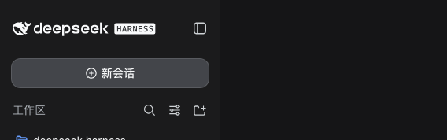

[English](README.en.md) | 简体中文


# dsh-balance-monitor

DeepSeek 余额与花费窗口，直接显示在 dsh 侧边栏底部。

一个极简的 [DeepSeek Harness](https://github.com/deepseek-ai/deepseek-harness) (dsh) 插件：在侧边栏底部（设置上方）显示当前会话渠道的余额/用量。**DeepSeek 官方渠道**显示余额与今日/7日/30日花费窗口（支持官方用量数据）；**火山方舟渠道**显示 Agent Plan 套餐额度（5小时/周/月进度条）；**Command Code 渠道**显示 5h/周/月 用量窗口（GOAT/Pro/Max 等套餐）；**Google AI Pro 渠道**（Antigravity 经 CLIProxyAPI 反代）显示 Gemini 的 5 小时/周剩余额度。样式完全使用官方设计令牌，克制内敛。

<p align="center">
  
</p>

## 功能

| 功能 | 实现 |
|---|---|
| 实时余额 | 服务端调用 `GET https://api.deepseek.com/user/balance`，使用 `$DSH_HOME/.credentials.yaml` 中的 `DEEPSEEK_API_KEY`（环境变量优先） |
| 今日/7日/30日花费（官方） | 配置 `DEEPSEEK_PLATFORM_TOKEN` 后，服务端调用官方用量接口 `platform.deepseek.com/api/v0/usage/cost`（与平台用量页同一份数据），按日期窗口累加。7日 = 今天往前 6 天，30日 = 今天往前 29 天（均含今天）。不受「在其他环境使用 API」影响 |
| 余额差值回退 | 无平台 token 或官方接口失败时，今日花费回退为余额差值账本（只累计余额下降，充值不冲账）；7日/30日显示 `—` |
| 渠道感知 | 卡片跟随当前会话的模型渠道（provider）自动显隐：DeepSeek 官方显示余额/花费；火山方舟显示 Agent Plan 进度条；Command Code 显示用量窗口；Google AI Pro（`cliproxy`）显示 5h/周 剩余额度；其他渠道显示「暂不支持」占位；无会话不显示 |
| 火山方舟 Agent Plan | 配置 AK/SK 后，调用 `GetAFPUsage` 控制面 API（SigV4 签名），显示 5小时/周/月 三档套餐额度进度条，颜色随用量变化（绿→黄→红） |
| Command Code 用量 | 配置 `COMMANDCODE_API_KEY` 后，调用 `api.commandcode.ai/alpha/billing/credits` 等接口，显示 5h/周/月 三窗口已用百分比与重置倒计时 |
| Google AI Pro 额度 | 配置 CPA 地址 + Basic 认证后，读取服务器上发布的静态额度快照 `GET /v0/google/quota`，显示 Gemini 的 5h 与每周剩余（显示为已用 %）及重置倒计时；快照由服务器上的探针在「有会话 + 冷静期已过」时才向 Google 探测（成功/失败后均冷静 1 小时）。0.9.0 起不再需要 CPA 管理密钥。**服务端需自行搭建，见[搭建指南](#google-ai-procliproxy渠道搭建)** |
| Claude Pro 官方额度 | 配置 CPA 管理地址后，读取 CPA 上定时任务探测的官方 OAuth 用量快照（`/v0/claude/quota`），按 5h 会话与 7 日周度窗口显示已用百分比、官方重置时间倒计时 |
| 位置 | 注册在官方 `sidebar.footer.action` 槽位 —— 设置上方，零 hack |
| 折叠态 | 收起后变为 36px 圆形，显示紧凑余额 + tooltip |
| 健壮性 | 60s 轮询 + 切回标签页时刷新；上游失败时保留上次数据（变淡标记 stale），不闪错误 |

## 安装

浏览器端 bundle 是手写的 classic script，**无构建步骤**，git 安装无需 prepare 脚本：

```sh
dsh plugin --profile web add "github:alanzhao0128/dsh-balance-monitor#main"
```

或从 npm：

```sh
dsh plugin --profile web add @alanzhao/dsh-balance-monitor
```

然后重启 Web UI（`dsh --profile web`）。卡片出现在展开的侧边栏底部、设置按钮上方。

> **版本要求**：`0.8.2+` 兼容 dsh `≥ 0.1.2-rc.1`（完美兼容 DSH Desktop `0.2.1-rc.2` 及更高版本，声明 `engines.dsh` 一等公民标准，全面支持 SettingsForms 与双轨设置）；dsh `0.1.2-rc.1` 宿主请固定安装 `0.7.1`。

## 配置

### 设置面板（推荐）

打开 dsh 设置（齿轮）→ **余额监控 / Balance Monitor**，可编辑卡片行为参数，保存后写入 `~/.dsh/settings.yaml` 的 `dsh-balance-monitor:` 段，**即时生效**（个别参数重启后生效）：

| 分组 | 字段 | 默认 | 说明 |
|---|---|---|---|
| 显示 | `ui.showCard` | `true` | 关闭后不显示任何渠道卡片 |
| 显示 | `ui.warnThreshold` | `30` | 用量 ≥ 该百分比进度条变黄 |
| 显示 | `ui.dangerThreshold` | `70` | 用量 ≥ 该百分比进度条变红 |
| 刷新 | `ui.pollMs` | `60` 秒 | 卡片刷新间隔（面板以秒显示，内部存毫秒） |
| 网络 | `network.cacheMs` | `40` 秒 | 服务端配额缓存，建议保持低于卡片刷新间隔 |
| 网络 | `network.timeoutMs` | `20` 秒 | 上游超时（火山方舟 / Command Code / DeepSeek 官方用量 / CPA 管理接口） |
| 网络 | `network.cpaBaseUrl` | 留空 | **你自己的** CLIProxyAPI 对外入口地址（Google AI Pro / Claude Pro 渠道的额度快照来源）；留空则该渠道显示「未配置 CPA 地址」，见下文[搭建指南](#google-ai-procliproxy渠道搭建) |
| 网络 | `network.cpaStaleMs` | `1200` 秒 | CPA 快照超过该时长即视为过期，插件自动补一次探测（建议大于 CPA 侧的定时探测周期） |
| 凭证 | `credentials.file` | `.credentials.yaml` | 凭证文档文件名（相对 `$DSH_HOME`） |

### 渠道凭证

设置面板的 **「渠道凭证」分组** 显示每个渠道展示余额/用量需要的凭证及其配置状态，按是否已被 DSH 模型配置引用区分只读/可写：

| 渠道 | 凭证 | 交互 |
|---|---|---|
| DeepSeek 官方 | `DEEPSEEK_API_KEY` | 只读（DSH 模型配置已引用），显示 ✅/⚠️ 状态 |
| DeepSeek 官方 | `DEEPSEEK_PLATFORM_TOKEN` | **可写**密码框（官方花费需要，会过期），带三段说明：它是什么 / 怎么取（platform.deepseek.com → F12 → Console → `JSON.parse(localStorage.getItem('userToken')).value`）/ 用来干什么 |
| 火山方舟 | `ARK_ACCESS_KEY_ID` | **可写**密码框（插件专属，DSH 模型用的是 `HUOSHAN_API_KEY`，两套不同凭证） |
| 火山方舟 | `ARK_SECRET_ACCESS_KEY` | **可写**密码框 |
| 火山方舟 | 区域 | 只读，自动跟随 DSH 模型配置（从 huoshan provider 的 `baseURL` 解析，如 `cn-beijing`） |
| Command Code | `COMMANDCODE_API_KEY` | 只读（DSH 模型配置已引用），显示 ✅/⚠️ 状态 |
| Google AI Pro | `CPA_BASIC_AUTH` | **可写**密码框，格式 `user:pass` —— CPA 服务器上 nginx 的 Basic 认证 |

可写框保存时走官方 `ctx.credentials.set()` 写入 `$DSH_HOME/.credentials.yaml`（`refs:` 段，带锁 + 原子写），插件自身不写文件。

### 凭证

凭证存于 `$DSH_HOME/.credentials.yaml`（Web 界面 Models 页写入，或直接编辑文件；插件通过官方 `ctx.credentials` 服务读取，环境变量优先）：

| 凭证 | 必需 | 用途 |
|---|---|---|
| `DEEPSEEK_API_KEY` | ✅ | 查询余额 `api.deepseek.com/user/balance` |
| `DEEPSEEK_PLATFORM_TOKEN` | 可选 | 查询官方用量（今日/7日/30日）。获取：登录 [platform.deepseek.com](https://platform.deepseek.com) → DevTools Console 执行 `JSON.parse(localStorage.getItem('userToken')).value`，把输出写入凭证 |

> ⚠️ `DEEPSEEK_PLATFORM_TOKEN` 是网页会话 token，**会过期**（官方返回 code 40002/40003 即过期）。过期时卡片显示红色提示并回退余额差值估算；在设置面板凭证组粘贴新 token 即可恢复，余额查询不受影响。

| 凭证 | 必需 | 用途 |
|---|---|---|
| `ARK_ACCESS_KEY_ID` | 火山方舟渠道时需要 | 火山方舟控制面 API 签名（AK/SK），查询 Agent Plan 套餐额度 |
| `ARK_SECRET_ACCESS_KEY` | 火山方舟渠道时需要 | 同上，Secret Access Key |
| `COMMANDCODE_API_KEY` | Command Code 渠道时需要 | Command Code API key（`user_...`），查询 5h/周/月 用量 |
| `CPA_BASIC_AUTH` | Google AI Pro 渠道时需要 | CPA 前置 nginx 的 Basic 认证，格式 `user:pass` |

> 火山方舟 AK/SK 获取：登录 [console.volcengine.com](https://console.volcengine.com) → 访问控制 → API 访问密钥 → 新建密钥。注意：AK/SK 是 IAM 账号级凭证，能操作所有资源，请妥善保管。

## Google AI Pro（CLIProxyAPI）渠道搭建

这个渠道**没有现成的公共接口可用**：Google 的 Antigravity 不像 Claude 那样在每次响应头里带额度，[CLIProxyAPI](https://github.com/router-for-me/CLIProxyAPI)（下称 CPA）自身也不暴露配额。所以想看到这张卡片，需要你自己在 CPA 所在服务器上准备一份**静态额度快照**，本插件只读这份快照。

> **⚠️ 0.9.0 起的不兼容变更（从 0.8.x 升级必读）**
>
> 旧版读取 CPA 管理接口上 `antigravity-priority` 插件的快照（需要 Basic 认证 + CPA 管理密钥两把锁）。**0.9.0 起不再使用**：插件只读 `GET {network.cpaBaseUrl}/v0/google/quota`（一份静态 JSON，仅需 Basic 认证），**不再访问 `/v0/management/*`，也不再需要 `CPA_MANAGEMENT_KEY`**（设置页该输入框已移除；已存的值无害，可自行删除）。升级后若卡片显示「CPA 上没有 /v0/google/quota 端点」，按下面的步骤搭一次即可；搭好后 nginx 也不必再把 `/v0/management/` 暴露到公网。

### 工作方式（与 Claude 卡片同构）

```
dsh 插件 ──HTTPS:443──▶ nginx（TLS + Basic 认证 + 限流）──▶ 静态文件 google-quota-cache.json
                                                              ▲ 写入
systemd timer（每 30s）▶ gemini_quota_probe.py ──┬─ 读本机 CPA 管理接口里的 success 计数（不出网）
                                                 └─ 仅在「有会话 + 冷静期已过」时向 Google 问 1 次额度
```

- Claude 卡片的额度来自每次响应头（CPA 被动记录），**没有任何额外探测**；Google 没有这个通道，所以由探针**在有 Gemini 会话时主动问一次**。
- 参考探针的触发规则（`examples/google-quota/`）：
  1. 每 30 秒唤醒，只读本机 CPA 管理接口里该账号的成功请求计数，**不出网**；
  2. 距上次探测尝试 **≥ 1 小时**（**成功与失败的冷静期都是 1 小时**，期内无论多少会话都不探测），**且**冷静期结束后出现了**新会话**（成功请求计数变大），才向 Google 发 **1 次** `retrieveUserQuotaSummary`；
  3. 没有会话 = 0 次上游请求；CPA 重启导致计数清零时只重置基线，不当作新会话；
  4. 取不到 Gemini 组 / 任何错误一律视为失败：**保留旧快照，绝不伪造数值**。
- 卡片只显示 **Gemini 的 5h 与每周窗口**（显示「已用 %」= 100 − 剩余），不探测 Claude/GPT 组。

> ⚠️ **风险提示**：通过第三方反代使用 Antigravity 账号本身可能违反 Google 的服务条款，有被限制或封停的风险。参考探针刻意做到「没有会话就不发任何请求、最多每小时 1 次」，但这不能消除该风险，请自行评估。

### 1. 快照格式（`GET /v0/google/quota` 的响应）

```json
{
  "observed_at": "2026-11-09T06:38:46+00:00",
  "plan": "pro",
  "account": "you@gmail.com",
  "groups": [
    {
      "id": "gemini",
      "plan": "pro",
      "account": "you@gmail.com",
      "windows": [
        { "level": "5h",     "remaining": 89.3, "resetAt": "2026-11-09T07:05:14Z" },
        { "level": "weekly", "remaining": 96.0, "resetAt": "2026-11-16T02:05:14Z" }
      ]
    }
  ]
}
```

`remaining` 是剩余百分比（0–100），`resetAt` 为 ISO-8601，`observed_at` 用于判定过期（见踩坑清单）。你也可以不用参考探针，自己产出同样格式的 JSON。

### 2. 探针（参考实现）

仅标准库的 Python 3 脚本，随仓库提供在 [`examples/google-quota/`](examples/google-quota/)（不随 npm 包发布）：

```bash
# ① 放脚本
install -m 755 examples/google-quota/gemini_quota_probe.py /opt/gemini-quota-probe/gemini_quota_probe.py
# ② 按你的 CPA 部署设置环境变量（默认值假设 CPA 装在 /root/cliproxyapi，详见脚本头部注释）
#    至少要能找到：CPA management key、auth 目录里的 antigravity-<email>.json、快照输出路径
# ③ systemd
install -m 644 examples/google-quota/gemini-quota-probe.{service,timer} /etc/systemd/system/
systemctl daemon-reload && systemctl enable --now gemini-quota-probe.timer
# ④ 离线自测（不联网、不需要 CPA），末行应为 ALL PASS
python3 examples/google-quota/test_gemini_quota_probe.py
```

- 首次运行（无状态文件）会立即探测一次，之后按上面的规则。看日志：`journalctl -u gemini-quota-probe.service --since -10min | grep 'gemini-quota\]'`（正常是 `cooldown (…s left…); skip` 或 `idle … skip`）。
- `--force` 立刻探测一次（**会真实请求 Google**）；`--dry-run` 只打印不落盘，且同样受冷静期约束。
- 探针只在**本机**访问 CPA 的 `/v0/management/auth-files` 读成功计数，management key 通过 `CPA_MGMT_KEY` 环境变量或 `GQP_SECRETS_FILE` 提供；CPA 容器只监听回环（`127.0.0.1:8317`），管理接口无需、也不应暴露到公网。

> **一个会让你白排查半天的坑**：请求的 `User-Agent` 必须是较新的 Antigravity 客户端版本（默认 `antigravity/2.29.0 windows/amd64`，可用 `GQP_UA` 改）。UA 过旧时 Google 只返回「Claude and GPT models」组、**不返回 Gemini 组**。参考探针遇到这种情况会判失败，而不是兜底成 100% —— 如果你自己写探针也别兜底，否则卡片会一直显示「已用 0%」。

### 3. nginx 反代（Basic 认证 + 路径封锁）

`/v1/`（推理）直通，`/v0/google/quota` 与 `/v0/claude/quota` 这类**精确路径**只读静态文件，其余路径一律 404；再加限流防爆破：

```nginx
limit_req_zone $binary_remote_addr zone=cpa_mgmt:10m rate=30r/m;

server {
  listen 443 ssl http2;          # nginx 1.24 及更早：http2 只能写在 listen 行上
  server_name cpa.example.com;   # ← 换成你自己的域名

  ssl_certificate     /etc/letsencrypt/live/cpa.example.com/fullchain.pem;
  ssl_certificate_key /etc/letsencrypt/live/cpa.example.com/privkey.pem;

  # 推理路径：直通，靠 CPA 自己的 API key 鉴权
  location /v1/ {
    # 关键：nginx 内置默认只有 1m，而 0.5M token 的上下文光文本就 ≥2MB，
    # 超限会直接 413（请求根本到不了 CPA），大上下文必须放开
    client_max_body_size 128m;
    # 大 body 直接流给上游，不先缓冲落盘
    proxy_request_buffering off;

    proxy_pass http://127.0.0.1:8317;
    proxy_buffering off;
    proxy_read_timeout 3600s;
    proxy_send_timeout 3600s;
  }

  # 额度快照：Basic 认证 + 限流，直接读探针写的静态文件（见 examples/google-quota/nginx-google-quota.conf）
  # 精确匹配的 location 不继承任何兄弟 location 的 auth_basic，必须在这里重复写
  location = /v0/google/quota {
    auth_basic "CPA quota";
    auth_basic_user_file /etc/nginx/.htpasswd-cpa;
    limit_req zone=cpa_mgmt burst=10 nodelay;
    default_type application/json;
    alias /var/www/cpa-static/google-quota-cache.json;
  }

  location / { return 404; }
}
```

> `/v0/management/*` 不再需要对外开放（0.9.0 起插件不访问它），上面的 `location / { return 404; }` 会把它挡掉；有条件可再叠一层 IP allowlist，或干脆只走内网 / WireGuard。

### 4. 插件侧

| 位置 | 填什么 |
|---|---|
| 设置面板 → 网络 → **CPA 地址** | `https://cpa.example.com`（你的 nginx 入口，**不要**带 `/v0` 后缀） |
| 设置面板 → 渠道凭证 → **Basic 认证** | `CPA_BASIC_AUTH`，格式 `user:pass`（对应 nginx 的 `.htpasswd-cpa`） |

### 5. 自检

```bash
# ① 无 Basic → 401（被 nginx 拦下）
curl -s -o /dev/null -w '%{http_code}\n' https://cpa.example.com/v0/google/quota

# ② 有 Basic → 200，并能看到 gemini 组的 5h / weekly
curl -s -u user:pass https://cpa.example.com/v0/google/quota

# ③ 管理接口不再对外：404
curl -s -o /dev/null -w '%{http_code}\n' -u user:pass https://cpa.example.com/v0/management/auth-files
```

### 6. 踩坑清单

- **卡片提示「CPA 上没有 /v0/google/quota 端点」**：nginx 没配该 location，或探针还没成功跑过一次（快照文件不存在）。先看 `journalctl` 里探针的输出，再看状态文件里的 `last_error`。
- **Google 行数字是淡显的（半透明）**：卡片按 `observed_at` 判过期，阈值 `network.cpaStaleMs`（默认 20 分钟）。Google 快照是「有会话才探测 + 约 1 小时冷静期」，闲置时必然比这更旧，所以会淡显 —— 属预期，不是故障。介意的话调大 `network.cpaStaleMs`（**与 Claude 卡共用此值**）。
- **数字很久不动**：先确认期间确有 Gemini 会话（没会话额度本就不变，探针也不会探测）；有会话但不动，多半在冷静期内（一小时内最多探测一次）；也可能上次探测失败，**失败后同样要等 1 小时**，看状态文件的 `last_error`。
- **只返回 Claude/GPT 组、缺 Gemini 组**：见上面的 User-Agent 坑。
- **`401`**：检查 `CPA_BASIC_AUTH` 格式是 `user:pass`，且与 nginx 的 htpasswd 一致。
- **`413 Request Entity Too Large`（响应体是 nginx 的 HTML 错误页）**：撞上了 nginx `client_max_body_size` 的**内置默认值 1m**。它跟 token 上限无关，请求在反代就被拒了，CPA 和模型根本没收到。0.5M token 的上下文光文本就 ≥2MB，所以只要用大上下文就必然触发 —— 按上面的示例在 `location /v1/` 里加上 `client_max_body_size 128m;`。注意该指令**不会**从兄弟 location 继承，必须写在 `/v1/` 自己（或写在上层 `server`/`http` 块里）。
- **大上下文上传慢**：`proxy_request_buffering off` 去掉了 nginx 的落盘缓冲，但 body 仍要完整传到反代，瓶颈是**客户端上行带宽**（实测 3MB ≈ 15s）。这部分不是配置能解决的。
- **`http2 on;` 在 nginx 1.24 上不支持**：老版本只能写 `listen 443 ssl http2;`，写错会 `unknown directive "http2"` 导致 nginx 起不来。
- **必须走 TLS**：Basic 是明文凭据，公网裸 HTTP 等于把密码广播出去。
- **推理与额度快照是两套鉴权**：`/v1/` 用的 API key（DSH 模型里的 `CLIPROXYAPI_KEY`）和 `/v0/google/quota` 用的 Basic 互不通用。

> 本项目的 npm 包不含任何服务端组件，也不附带默认地址 —— 你需要自己部署 CPA + 探针 + 反代（参考实现见 `examples/google-quota/`），并把地址填进 `network.cpaBaseUrl`。

## 工作原理

一个插件行同时承担两种角色（`dsh.bundle` patch + `dsh.client` 浏览器注册表声明）：

- **服务端半**（`lib/index.js`）—— 通过 `connection.fetch.register` 在共享 `/api` 通道上注册 6 个 RPC 端点（继承官方信任围栏与浏览器认证）：`balance/snapshot`（DeepSeek 余额+官方用量窗口）、`ark-quota/snapshot`（火山方舟 Agent Plan 额度，每次调用签 AK/SK SigV4 调 `GetAFPUsage`，缓存 40s——严格小于浏览器端 60s 轮询，保证每次轮询都触发上游刷新）、`cmdcode-quota/snapshot`（Command Code 用量，Bearer 调 `api.commandcode.ai/alpha/billing/credits` 等，缓存 40s）、`cpa-quota/snapshot`（Google AI Pro 配额，读 CPA 上发布的静态快照 `/v0/google/quota`）、`credential-status/snapshot`（凭证状态与区域）、`session-provider/snapshot`（按会话解析渠道 provider）。缓存与超时时长来自设置面板（`network.*`）。凭证统一走官方 `ctx.credentials` 服务读取。
- **浏览器半**（`lib/client.js`）—— 零依赖 classic-script bundle，注册 `sidebar.footer.action` 条目。通过 `sessions.list` 订阅 + 1s 轻量轮询 `/session-provider` RPC（携带当前 `sessionId`，host 端按该会话的 `modelSelection` 投影解析渠道；0.7.1 起跨会话切换也会跟随）感知当前会话的 provider，再按渠道注册表分发：`deepseek-official` 渲染余额卡片（每 60s 轮询一次余额，标签页重新可见时立即刷新）；未注册渠道渲染「暂不支持」占位；无会话则不渲染。渠道目录变化（`llm/adapters-updated` 事件）会立即触发重新判定。同时注册 `settings.section` 设置页（余额监控），读写 `dsh-balance-monitor` 命名空间；`credential-status` 端点（凭证状态 + 区域解析，host 端从 `ctx.llm`/`ctx.settings` 判定哪些凭证被 DSH 模型配置引用）。

状态文件（`$DSH_HOME/storages/balance-monitor.json`）：

```json
{
  "date": "2026-08-17",
  "dayStart": 100.0,
  "lastTotal": 97.7,
  "lastCurrency": "CNY",
  "spent": 1.65,
  "spent7d": 5.24,
  "spent30d": 18.54,
  "spentSource": "official",
  "updatedAt": 1755400000000
}
```

`spentSource` 为 `official`（官方接口）或 `estimate`（余额差值估算）。

## 安全说明

- API key 与平台 token 永不离开服务端：浏览器半只能通过 RPC 通道看到余额/花费数字，接触不到凭证。
- 通道走 `loopback` 信任策略。
- 无遥测，网络请求仅官方余额接口与官方用量接口。

## 目录结构

```
dsh-balance-monitor/
├── package.json        # dsh.bundle (patch) + dsh.client (浏览器注册表)
├── cordis.patch.yml    # 插入这一个组合插件行
├── examples/google-quota/   # Google AI Pro 额度探针参考实现（脚本 + systemd + nginx 片段 + 离线测试；仅在仓库内，不随 npm 包发布）
└── lib/
    ├── index.js        # 服务端半：6 个 /api RPC 端点（余额/方舟/Command Code/Google AI Pro/凭证状态/会话渠道）+ settings 接入
    ├── config.js       # 设置 schema + 默认值（与设置面板字段一一对应）
    ├── signature.js    # 火山方舟 SigV4 签名
    └── client.js       # 浏览器半：侧边栏卡片 + 设置页（手写，无构建）
```

## 开发

无需工具链。直接改 `lib/*.js`；bundle 格式与官方 `tsdown` 预设产物一致（`window.__ModuleLoader__.load({ id, factory })`）。

## License

MIT
